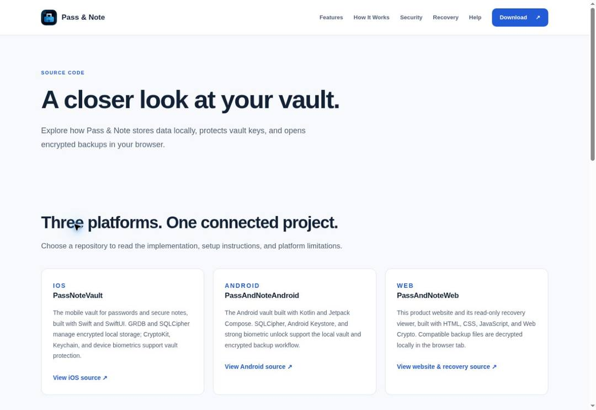
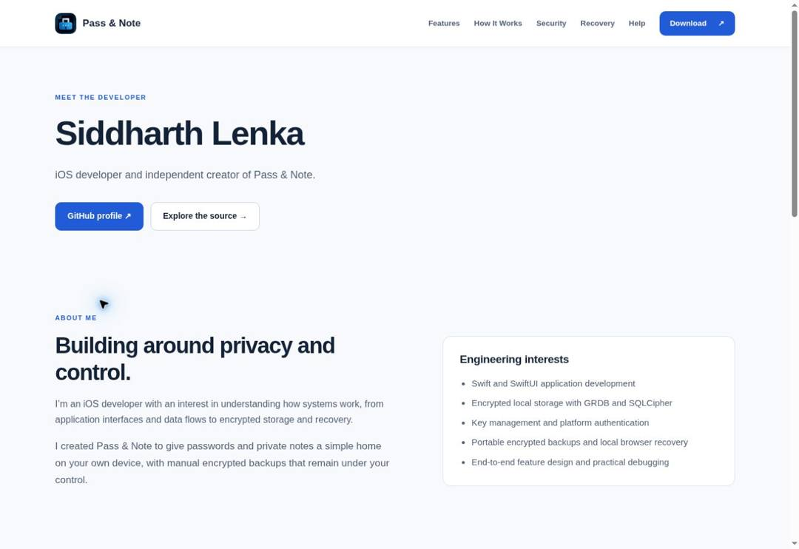

# Pass & Note website

A static product website for the Pass & Note local-first mobile vault, with a working local password generator and read-only encrypted backup recovery tool. The visual system follows the browser/OS light or dark preference automatically, including changes during an open session. Light mode uses an off-white background, navy text, and white cards; dark mode uses deep navy surfaces and light text. Both use blue accents and system fonts. No build step, third-party scripts, or runtime dependencies are required.

## Website structure

| Route | Purpose |
| --- | --- |
| `/` | Product introduction, feature summary, security overview, recovery overview, and app downloads |
| `/features/` | Vault, Protection, Backups, and Recovery features; working password generator |
| `/how-it-works/` | Visual guide from creating a vault through backup and recovery |
| `/security/` | Encryption architecture, key management, platform protections, threat model, and technical specifications |
| `/recovery/` | Working encrypted-file recovery viewer |
| `/source/` | Public repositories, implementation overview, licence and audit distinction |
| `/developer/` | Developer profile, engineering interests, and project links |
| `/help/` | Getting Started, Vault Management, Backups, and Troubleshooting |
| `/privacy/` | Privacy Policy |
| `/terms/` | Terms & Conditions |

The logo links home. Every page uses the same navigation: **Features · How It Works · Security · Recovery · Help · Download**. Download links to the homepage download section. On small screens, a keyboard-accessible menu replaces the desktop navigation.

Old homepage links for `#password-generator`, `#supported`, `#mobile-guide`, `#security`, and `#recovery` redirect to their new locations. About, contact, and legal links live in the footer.

## Run locally

Serve the project root over HTTP:

```bash
python3 -m http.server 8000 --bind 127.0.0.1
```

Open [http://localhost:8000](http://localhost:8000). Direct page routes require serving the entire project root; do not open individual HTML files using `file://`.

## Working tools

The generator at `/features/#password-generator` provides 16, 32, and 64-character passwords. It uses `crypto.getRandomValues`, rejection sampling, and a shuffle to include uppercase, lowercase, digits, and symbols without modulo bias. It defaults to 32 characters and does not save generated passwords.

The viewer at `/recovery/#open-viewer` accepts files up to 25 MB:

| Extension | Contents |
| --- | --- |
| `.pnvault` | Passwords and secure notes together |
| `.pnpass` | Password records |
| `.pnnote` | Secure notes |

All use the PASSNOTE v1 encrypted container with AES-256-GCM, PBKDF2-HMAC-SHA256, a 32-byte salt, and a combined nonce/ciphertext/tag payload. Current mobile exports use 600,000 derivation iterations. Container metadata is readable; record contents are encrypted.

Recovery workflow:

1. Choose a compatible encrypted export.
2. Enter the Master Password used when it was created.
3. Read passwords and notes, reveal passwords, and copy values as needed.
4. Choose Close File when finished, then clear copied values from the system clipboard.

The website does not create a vault, edit records, upload backup contents, or save decrypted data. Privacy Lock removes readable values when the tab enters the background. Two minutes of inactivity clears the selected file by default; per-session settings allow five or ten minutes. The recovery tool does not use localStorage or sessionStorage for vault data.

## Project files

```text
index.html         Product homepage and store links
features/          Feature catalog and generator markup
how-it-works/      Visual mobile workflow
security/          Security architecture and specifications
recovery/          Recovery landing page, file picker, and viewer markup
source/            Public repository links and implementation overview
developer/         Developer profile and project links
help/              Setup, vault, backup, and troubleshooting guides
privacy/           Privacy Policy
terms/             Terms & Conditions
assets/            App icon
styles.css         Automatic light/dark themes, responsive layouts, and tool styling
site.js            Mobile navigation, guide anchors, and old-link routing
generator.js      Local password generation and copying
app.js             Recovery file selection, rendering, and session controls
crypto.js          PASSNOTE container validation and decryption
```

## Maintaining content

Store URLs live in the `download` section of `index.html`. The app icon is `assets/app-icon.png`. Navigation and footer markup are static in each page; update all ten pages together when changing shared links. `styles.css` and `site.js` are shared by all pages. Update asset query versions when deploying changes.

Security content was checked against the local mobile implementations in September 2026. iOS declares SQLCipher 4.10.0 and GRDB.swift 6.24.1; Android declares SQLCipher 4.17.0. SQLCipher defaults are identified and linked to upstream documentation. This describes inspected source, not a verification of published store binaries or an independent audit.

Keep mobile vault encryption separate from export encryption, background privacy shielding separate from database locking, and mobile clipboard expiration separate from the browser clipboard. Only document platform protections that the implementation uses.

## Deployment and validation

Deploy all HTML directories, `assets`, and the four JavaScript files (`site.js`, `generator.js`, `app.js`, and `crypto.js`) plus `styles.css` to a static host using HTTPS. Directory-index routing must serve each route’s `index.html`. The pages include a restrictive Content Security Policy and do not need application network connections.

Before release, validate responsive navigation, download links, generator lengths and clipboard access, all three backup formats, incorrect passwords, corrupted files, Privacy Lock, session clearing, and mobile-app export compatibility. Keep the Privacy Policy, Terms, and store disclosures consistent with actual app behavior.

The legal document wording on the Privacy Policy and Terms pages matches the pre-redesign versions, including the original legal-content commit `4ceb0c3`. Their shared navigation, layout, and theme can change without editing the legal documents.


## Screenshots and live preview





Explore the [product homepage](https://passandnote.com/),
[security architecture](https://passandnote.com/security/), and
[recovery viewer](https://passandnote.com/recovery/). The homepage vault illustration
is a product illustration rather than an app screenshot. Mobile screenshots are
available from the linked [App Store](https://apps.apple.com/app/id6801015333) and
[Google Play](https://play.google.com/store/apps/details?id=com.passandnote.vault) listings.

## Limitations

- Recovery is read-only; this website is not a hosted vault or sync service.
- A compatible encrypted backup and its original export password are required.
- Web Crypto requires HTTPS or a trusted localhost context; clipboard access also depends on browser permissions.
- Recovery files are limited to 25 MB. Forgotten passwords cannot be reset.
- A compromised browser, extension, device, or clipboard can expose readable data.
- Source availability is not an independent audit or verification of store binaries.

## Related repositories

- [iOS vault — PassNoteVault](https://github.com/siddharthlenka/PassNoteVault)
- [Android vault — PassAndNoteAndroid](https://github.com/siddharthlenka/PassAndNoteAndroid)
- [Website and recovery viewer — PassAndNoteWeb](https://github.com/siddharthlenka/PassAndNoteWeb)

Developer: [Siddharth Lenka](https://passandnote.com/developer/) ·
[Source overview](https://passandnote.com/source/) ·
[Security architecture](https://passandnote.com/security/)

## Security reporting

Report potential vulnerabilities privately to **support@passandnote.com**.
See [SECURITY.md](SECURITY.md) for details. Do not post private vault data in issues.

## Licence

The original project code and assets are publicly available for inspection with
**all rights reserved**; this is not an open-source licence granting reuse rights.
See [LICENSE](LICENSE). Third-party dependencies retain their own licence terms.
